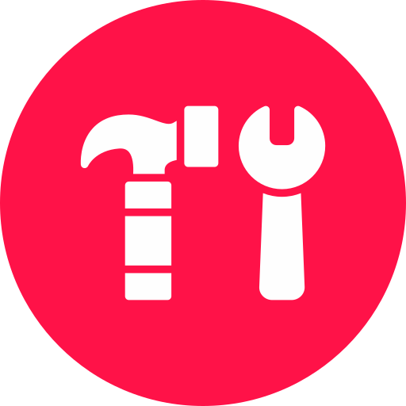
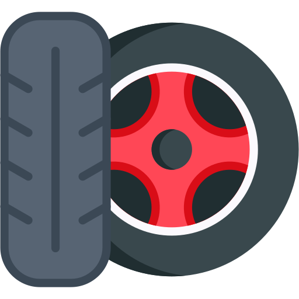
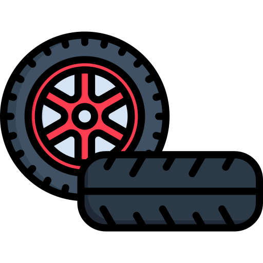
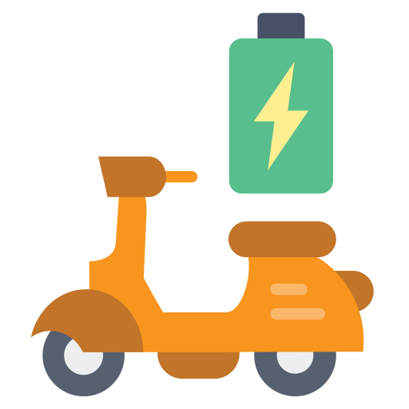
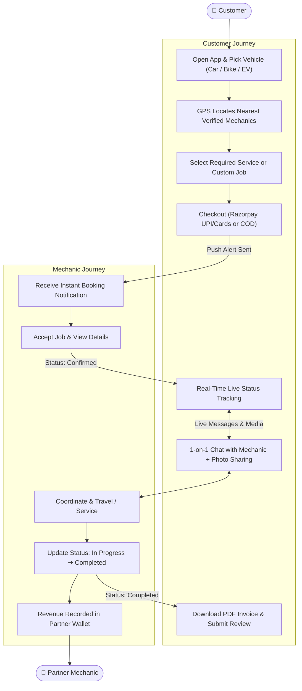

<div align="center">

  

  # **MechTech**
  ### *Trusted Mechanics. On-Time Service.*

  **On-Demand Vehicle Service & Emergency Mechanic Booking Platform for Cars, Bikes, and Electric Vehicles (EVs).**

  <p align="center">
    <a href="https://play.google.com/store/apps/details?id=com.mechtech.mechanic.apps&hl=en_IN">
      
    </a>
    
    
    
  </p>

  <a href="https://play.google.com/store/apps/details?id=com.mechtech.mechanic.apps&hl=en_IN">
    
  </a>

</div>

---

## 📌 Table of Contents

- [What is MechTech?](#-what-is-mechtech)
- [Tech Stack Used](#-tech-stack-used)
- [Supported Vehicles](#-supported-vehicles)
- [How MechTech Works (Complete App Workflow)](#-how-mechtech-works-complete-app-workflow)
  - [1. Customer Workflow (Booking to Delivery)](#1-customer-workflow-booking-to-delivery)
  - [2. Mechanic Workflow (Fulfillment & Earnings)](#2-mechanic-workflow-fulfillment--earnings)
  - [3. End-to-End Workflow Diagram](#3-end-to-end-workflow-diagram)
- [Key App Features](#-key-app-features)
- [Download & Links](#-download--links)

---

## 💡 What is MechTech?

**MechTech** is an on-demand automotive emergency and vehicle repair platform designed to connect vehicle owners with verified nearby mechanics and garages in seconds. 

Whether facing a sudden highway breakdown, punctured tyre, dead battery, routine servicing, or high-voltage EV diagnostic issues, MechTech eliminates the stress of finding trusted mechanical help.

### Core Highlights:
- 📍 **Instant Nearby Discovery:** Finds certified mechanics closest to you based on live GPS location and verified reviews.
- 📌 **All Vehicles Covered:** Tailored service catalogs for **Cars🚗**, **Bikes🏍️**, and **Electric Vehicles (EVs)⚡**.
- 💳 **Online & Cash on Delivery:** Integrated Razorpay checkout (UPI, cards, net banking) alongside Cash-on-Delivery (COD).
- 💬 **Live In-App Chat:** Real-time messaging with assigned mechanics including photo sharing.
- 📄 **Digital Invoicing:** Itemized PDF tax invoice generated and saved straight to your phone.

---

## 💻 Tech Stack Used

| Layer | Technology | What It Does in MechTech |
| :--- | :--- | :--- |
| **Mobile App** | **Flutter & Dart** | Cross-platform, high-performance UI with custom dark mode (`#0D0B18`) and neon accents (`#00E676`, `#00B0FF`). |
| **State Management** | **Provider** (`AppState`) | Reactive real-time data sync across customer bookings, active jobs, chat, and wallet. |
| **Database & Auth** | **Google Cloud Firestore & Firebase Auth** | Real-time database for live status updates, chat streams, mechanic catalogs, and secure authentication. |
| **Serverless API** | **Vercel Functions (Node.js)** | Handles Razorpay order creation, payment cryptographic signature verification, and push notifications. |
| **Payments** | **Razorpay & COD** | Smooth payment gateway for UPI (Google Pay, PhonePe, Paytm), Debit/Credit Cards, plus Cash-on-Delivery. |
| **Location & Maps** | **Geolocator & Geocoding** | Detects real-time device coordinates to calculate distance to nearby mechanics and reverse geocode addresses. |
| **Notifications** | **Firebase Cloud Messaging (FCM)** | Instant push alerts for booking confirmations, dispatch updates, and incoming chat messages. |
| **Document Engine** | **PDF & MediaStore Plus** | Dynamically generates branded, downloadable digital service invoices directly to the device. |

---

## 🚘 Supported Vehicles

<table>
  <tr>
    <td align="center" width="33%">
      <br /><br />
      <b>🚗 Cars</b><br />
      <small>Periodic Service • Tyres & Balancing • Brake Inspection • Clutch Repair • Denting & Painting • Car Spa & Wash</small>
    </td>
    <td align="center" width="33%">
      <br /><br />
      <b>🏍️ Bikes & Scooters</b><br />
      <small>Engine Oil Change • Chain Cleaning & Lube • Puncture & Air Fix • Brake Shoes • Lights & Wiring</small>
    </td>
    <td align="center" width="33%">
      <br /><br />
      <b>⚡ Electric Vehicles (EV)</b><br />
      <small>Battery Health Diagnostic • Motor Service • Charging Port Repair • Software Diagnostics • BMS Check</small>
    </td>
  </tr>
</table>

---

## 🔄 How MechTech Works (Complete App Workflow)

MechTech operates seamlessly with a unified, dual-role system connecting customers with service partners.

### 1. Customer Workflow (Booking to Delivery)

```
[1. Select Vehicle] ──► [2. Find Nearby Mechanic] ──► [3. Choose Service]
                                                              │
                                                              ▼
[6. Review & PDF Invoice] ◄── [5. Live Tracking & Chat] ◄── [4. Payment & Confirm]
```

1. **Select Vehicle Type:**
   - The user opens the app and chooses their vehicle: **Car**, **Bike**, or **Electric Vehicle (EV)**.
2. **Find Nearby Mechanics (GPS Auto-Detection):**
   - The app detects current GPS coordinates and shows verified mechanics sorted by proximity (distance in km) and user ratings (e.g. 4.8 ⭐).
3. **Select Service or Custom Request:**
   - Choose from categorized service packages (Periodic Maintenance, Brake Check, Tyres, Battery, EV Diagnostics) or describe a custom breakdown issue.
4. **Choose Payment & Confirm:**
   - Review booking summary and pay securely online via **Razorpay** (UPI, Credit/Debit card) or select **Cash on Delivery (COD)**. Referral coins can also be applied.
5. **Real-Time Tracking & Direct Chat:**
   - Watch booking status update live: `Pending` ➔ `Confirmed` ➔ `In Progress` ➔ `Completed`.
   - Open 1-on-1 in-app chat with the mechanic to share exact location, photos, and progress.
6. **Service Completion & Digital Invoice:**
   - Once the service is marked complete, the customer downloads an itemized **PDF Tax Invoice** directly to their phone and leaves a rating & review.

---

### 2. Mechanic Workflow (Fulfillment & Earnings)

```
[1. Receive Push Alert] ──► [2. Accept Booking] ──► [3. Chat & Coordinate]
                                                               │
                                                               ▼
[6. Track Earnings] ◄─────── [5. Complete Service] ◄──────── [4. Start Job]
```

1. **Instant Booking Notification:**
   - Partner mechanics receive an immediate push notification with vehicle model, customer location, and service requested.
2. **Review & Accept:**
   - Mechanic accepts the job from the partner dashboard.
3. **Coordinate via Chat / Call:**
   - Direct communication with customer to clarify requirements or navigate to the breakdown spot.
4. **Service Execution:**
   - Updates status to `In Progress` when work begins.
5. **Mark as Complete:**
   - Verifies work and marks job `Completed`, automatically triggering payment settlement and customer invoice generation.
6. **Earnings & Catalog Management:**
   - Views daily and weekly earnings in the **Earnings Dashboard** and can add or customize service offerings anytime.

---

### 3. End-to-End Workflow Diagram



---

## ✨ Key App Features

- **Dual-Role Single App:** Seamless role-based interface for both Customers and Mechanic Partners.
- **EV Specialty Diagnostics:** Specialized support for electric vehicle battery health, charging circuits, and electric motor diagnostics.
- **Proximity Radar:** Shows closest mechanics with exact distance in km and operating availability.
- **Secure Online Payments:** Powered by Razorpay with automated backend cryptographic verification.
- **Cash on Delivery (COD):** Hassle-free offline payment option for roadside emergencies.
- **In-App Messaging:** Built-in real-time chat with photo upload support so you can show the mechanic the exact problem.
- **In-App Wallet & Referrals:** Earn bonus credits by referring friends and use wallet balances on bookings.
- **Offline PDF Invoices:** Generates official itemized service receipts saved directly to Android Downloads.

---

## 📲 Download & Links

- **Google Play Store:** [Download App](https://play.google.com/store/apps/details?id=com.mechtech.mechanic.apps&hl=en_IN)
- **GitHub Repository:** [SurajChaurasia84/MechTech](https://github.com/SurajChaurasia84/MechTech)
- **Privacy Policy:** [Privacy Policy](https://surajchaurasia84.github.io/MechTech/)

<div align="center">
  <sub>Built with ❤️ for drivers and mechanics everywhere.</sub>
</div>